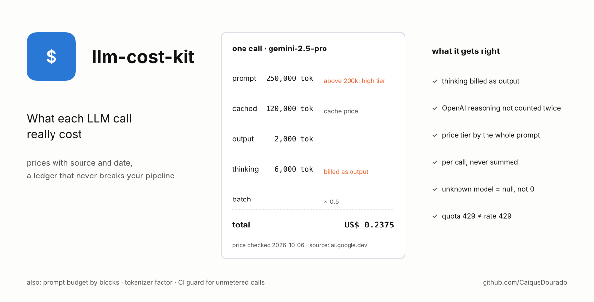
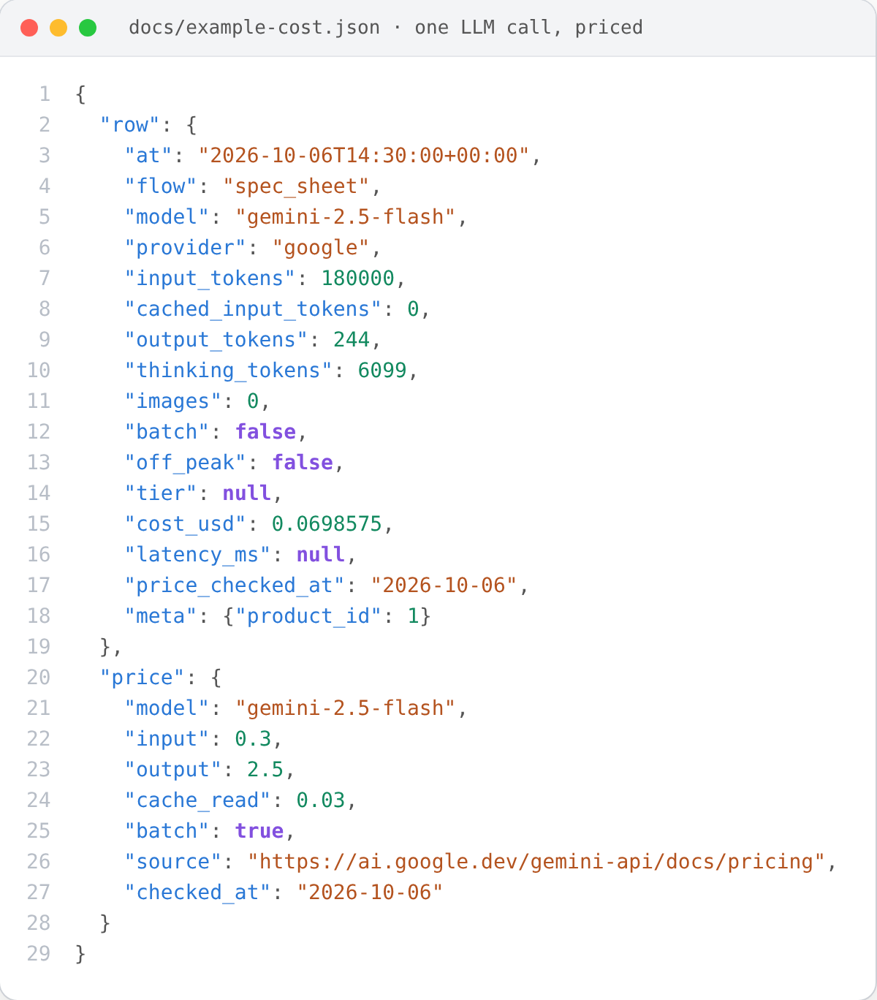
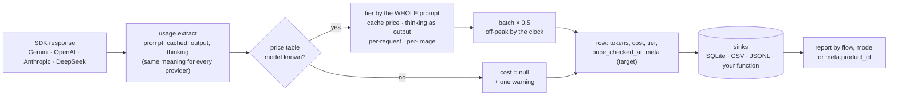
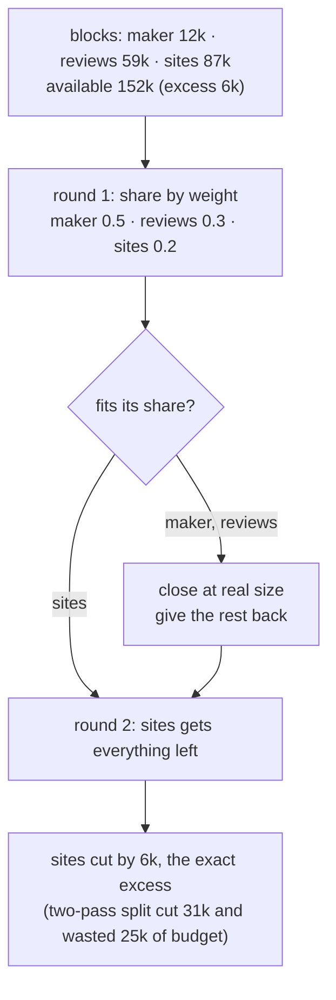

# llm-cost-kit

[](https://github.com/CaiqueDourado/llm-cost-kit/actions/workflows/tests.yml)
[](LICENSE)
[](pyproject.toml)

[Leia em português](README.pt-BR.md)



Know what each LLM call really cost, with prices you can trace back to the provider's page. No dependencies.

```python
from llm_cost_kit import Ledger, PriceTable, SQLiteSink, target, timer

prices = PriceTable.load("prices.yaml")          # every price has `source` and `checked_at`
ledger = Ledger(prices, SQLiteSink("costs.sqlite"))

for product in products:
    with target(product_id=product["id"]):      # every row inside gets product_id
        with timer() as t:
            resp = client.models.generate_content(model="gemini-2.5-flash", contents=prompt)
        ledger.record(resp, model="gemini-2.5-flash", flow="spec_sheet", latency_ms=t.ms)
```

```bash
$ llm-cost-kit report costs.sqlite --by meta.product_id
$ llm-cost-kit prices prices.yaml        # what is unchecked, stale or looks like a typo
$ llm-cost-kit check src/ --recorder record   # files that call an LLM and record nothing
```

## What a cost record looks like

The row `ledger.record()` writes for the Gemini call in [`examples/quickstart.py`](examples/quickstart.py), next to
the price entry it used. The 6,099 thinking tokens are billed as output: (180,000 × 0.30 + 6,343 × 2.50) / 1M = US$ 0.0699.



Full JSON: [`docs/example-cost.json`](docs/example-cost.json), written by [`scripts/make_json.py`](scripts/make_json.py).

## Where it comes from

The author's product-review site generates spec sheets, comparisons, rankings, articles and video scripts with Gemini, OpenAI and other models. A study to cut that bill found that the bill itself was being measured wrong, in ways that each changed decisions:

| What went wrong | Measured |
|---|---|
| Thinking tokens left out of the cost (Gemini reports them apart from the output, and bills them as output) | under-billed **5.1x** in a test round, 8.9x in the worst case; 86 rows already stored went from US$ 2.55 to US$ 4.82 when fixed |
| A day of calls summed and priced as one | estimate **46.6%** too high: the sum crossed a price tier that no single call crossed |
| A cache price typed as the input price | the model looked 4x cheaper than it was, and won comparisons it should have lost |
| Unknown model priced at 0 | the unpriced model looked like the cheapest |
| No cost recorded at all | **48 of 63** production scripts called an LLM with no meter; nobody knew what the month had cost |
| tiktoken used to stay under the 200k price tier | Google's own count was 3.5% to 23.4% higher; 8 real prompts crossed the tier unnoticed |
| `429` retried three times | it was `insufficient_quota`: the account had no credit, and the retries only failed slower |

With the bill measured correctly, the study took a new product (content and images) from **US$ 1.00 to US$ 0.14 (−85.8%)**. This library is that measuring layer, rewritten without the project's database.

## How it works

How a call is priced:



How a prompt is cut to fit (`budget.allocate`):



### The pieces

| Module | What it does |
|---|---|
| `prices` | `PriceTable` from YAML/JSON. Each model: `input`, `output`, `cache_read` (`null` = no discount, `"?"` = not checked), `high_tier` (price above N prompt tokens), `batch`, `off_peak` window, `per_request`, `per_image`, `source`, `checked_at`, `retired`. `unchecked()`, `stale(days)`, `unchecked_cache()`, `check_sanity()`. `cost()` per call. |
| `usage` | `extract(resp)` for Gemini, OpenAI Chat and Responses, DeepSeek and Anthropic. Normalises: prompt includes cache; output excludes thinking; thinking apart. OpenAI's reasoning is inside `completion_tokens` and is not added again; Anthropic's cache reads and writes are added to the prompt. |
| `ledger` | `Ledger(prices, *sinks).record(...)`: never raises, but failures go to stderr and `ledger.errors`. `target(**fields)` (context-local, safe with threads and asyncio) attributes calls without changing function signatures. `summarize`, `read_rows`. |
| `errors` | `should_retry(err)` and `kind(err)`: account (no credit, billing, plan) before transient, because quota messages contain "429". |
| `tokens` | `measure_factor` (your count vs the provider's), `safe_ceiling` (by the model's tier), `cliff_check` (provider's counter on big prompts only, warns when a call hits the high tier). |
| `budget` | `allocate` (blocks by weight, in rounds) and `cut_at_boundary` (cut between items, report which items fell out). |
| `guard` | `unmetered(path)`: files that call an LLM and never call your recorder. Run it in CI. |

The example table [`examples/prices.yaml`](examples/prices.yaml) shows every field with prices the author read on each provider's page, with their dates. **Check them again before trusting them**: prices change, and the table says when each one was last read.

## Install

```bash
pip install "llm-cost-kit[yaml] @ git+https://github.com/CaiqueDourado/llm-cost-kit"
```

No required dependencies; `[yaml]` adds PyYAML to read YAML price files (JSON works without it).

## Limits

- Off-peak follows the clock at record time; a call that starts off-peak and ends at peak is priced by its end.
- Cache storage fees (explicit caches billed per hour) and Anthropic cache-write surcharges are not priced; cache writes are charged at the input price.
- The guard checks that a recorder is called in the file, not that every call is recorded.

## Related

- [llm-batch-kit](https://github.com/CaiqueDourado/llm-batch-kit): batch APIs at half price without mismatched answers or paying twice; `ledger_hook` records each answer here at the batch price.
- [scrapladder](https://github.com/CaiqueDourado/scrapladder) and [transcriptladder](https://github.com/CaiqueDourado/transcriptladder): the fetch and transcript layers of the same crawler.

## License

[MIT](LICENSE) © Caique Dourado
