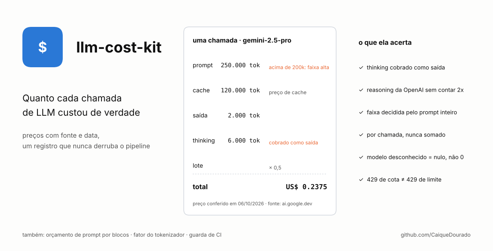
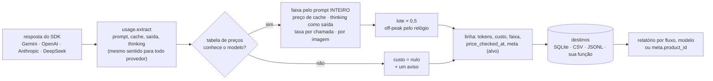
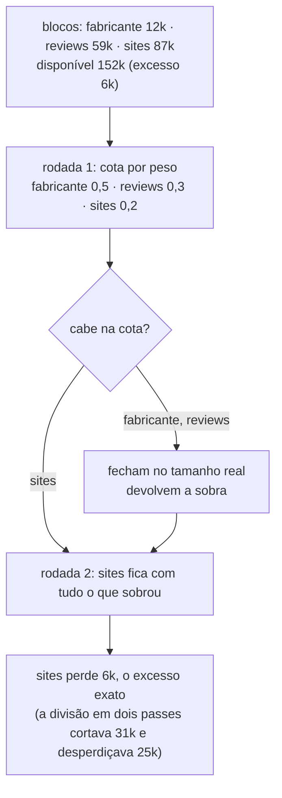

# llm-cost-kit

[](https://github.com/CaiqueDourado/llm-cost-kit/actions/workflows/tests.yml)
[](LICENSE)
[](pyproject.toml)

[Read in English](README.md)



Saiba quanto cada chamada de LLM custou de verdade, com preços que você consegue rastrear até a página do provedor. Sem dependências.

```python
from llm_cost_kit import Ledger, PriceTable, SQLiteSink, target, timer

prices = PriceTable.load("prices.yaml")          # todo preço tem `source` e `checked_at`
ledger = Ledger(prices, SQLiteSink("costs.sqlite"))

for product in products:
    with target(product_id=product["id"]):      # toda linha registrada aqui dentro ganha o product_id
        with timer() as t:
            resp = client.models.generate_content(model="gemini-2.5-flash", contents=prompt)
        ledger.record(resp, model="gemini-2.5-flash", flow="spec_sheet", latency_ms=t.ms)
```

```bash
$ llm-cost-kit report costs.sqlite --by meta.product_id
$ llm-cost-kit prices prices.yaml        # o que não foi conferido, está velho ou parece erro de digitação
$ llm-cost-kit check src/ --recorder record   # arquivos que chamam LLM e não registram nada
```

## De onde vem

O site de análises de produtos do autor gera fichas técnicas, comparativos, rankings, artigos e roteiros de vídeo com Gemini, OpenAI e outros modelos. Um estudo para cortar essa conta descobriu que a própria conta estava sendo medida errado, e cada erro mudava decisões:

| O que dava errado | Medido |
|---|---|
| Tokens de thinking fora do custo (o Gemini os informa à parte da saída e os cobra como saída) | subfaturou **5,1x** numa rodada de teste, 8,9x no pior caso; 86 linhas já gravadas foram de US$ 2,55 para US$ 4,82 quando corrigidas |
| Um dia de chamadas somado e precificado como se fosse uma só | estimativa **46,6%** alta demais: a soma passou de uma faixa de preço que nenhuma chamada passou |
| Preço de cache digitado como preço de entrada | o modelo parecia 4x mais barato do que era, e ganhava comparações que deveria perder |
| Modelo desconhecido com preço 0 | o modelo sem preço parecia o mais barato |
| Nenhum custo registrado | **48 de 63** scripts de produção chamavam LLM sem medidor; ninguém sabia quanto o mês tinha custado |
| tiktoken usado para ficar abaixo da faixa de 200k | a contagem do próprio Google dava de 3,5% a 23,4% a mais; 8 prompts reais passaram da faixa sem ninguém ver |
| `429` repetido três vezes | era `insufficient_quota`: a conta estava sem crédito, e as tentativas só falhavam mais devagar |

Com a conta medida direito, o estudo levou um produto novo (conteúdo e imagens) de **US$ 1,00 para US$ 0,14 (−85,8%)**. Esta biblioteca é essa camada de medição, reescrita sem o banco do projeto.

## Como funciona

Como uma chamada é precificada:



Como um prompt é cortado para caber (`budget.allocate`):



### As peças

| Módulo | O que faz |
|---|---|
| `prices` | `PriceTable` a partir de YAML/JSON. Cada modelo: `input`, `output`, `cache_read` (`null` = sem desconto, `"?"` = não conferido), `high_tier` (preço acima de N tokens de prompt), `batch`, janela `off_peak`, `per_request`, `per_image`, `source`, `checked_at`, `retired`. `unchecked()`, `stale(dias)`, `unchecked_cache()`, `check_sanity()`. `cost()` por chamada. |
| `usage` | `extract(resp)` para Gemini, OpenAI Chat e Responses, DeepSeek e Anthropic. Normaliza: o prompt inclui o cache; a saída não inclui o thinking; o thinking vem à parte. O reasoning da OpenAI já está dentro de `completion_tokens` e não é somado de novo; as leituras e gravações de cache da Anthropic são somadas ao prompt. |
| `ledger` | `Ledger(prices, *destinos).record(...)`: nunca levanta exceção, mas as falhas vão para o stderr e para `ledger.errors`. `target(**campos)` (local ao contexto, seguro com threads e asyncio) atribui as chamadas sem mudar a assinatura das funções. `summarize`, `read_rows`. |
| `errors` | `should_retry(err)` e `kind(err)`: conta (sem crédito, faturamento, plano) antes de transitório, porque a mensagem de cota contém "429". |
| `tokens` | `measure_factor` (a sua contagem contra a do provedor), `safe_ceiling` (pela faixa do modelo), `cliff_check` (contador do provedor só nos prompts grandes; avisa quando a chamada cai na faixa alta). |
| `budget` | `allocate` (blocos por peso, em rodadas) e `cut_at_boundary` (corta entre itens e diz quais ficaram de fora). |
| `guard` | `unmetered(caminho)`: arquivos que chamam LLM e nunca chamam o seu registrador. Rode no CI. |

A tabela de exemplo [`examples/prices.yaml`](examples/prices.yaml) mostra todos os campos com os preços que o autor leu na página de cada provedor, com as datas. **Confira de novo antes de confiar**: preços mudam, e a tabela diz quando cada um foi lido pela última vez.

## Instalação

```bash
pip install "llm-cost-kit[yaml] @ git+https://github.com/CaiqueDourado/llm-cost-kit"
```

Sem dependências obrigatórias; `[yaml]` adiciona o PyYAML para ler tabelas em YAML (JSON funciona sem ele).

## Limites

- O off-peak segue o relógio na hora do registro; uma chamada que começa fora de pico e termina no pico é precificada pelo fim.
- Armazenamento de cache (cache explícito cobrado por hora) e o adicional de gravação de cache da Anthropic não entram no preço; a gravação de cache é cobrada pelo preço de entrada.
- A guarda confere que o registrador é chamado no arquivo, não que toda chamada é registrada.

## Relacionados

- [llm-batch-kit](https://github.com/CaiqueDourado/llm-batch-kit): APIs de lote pela metade do preço, sem respostas trocadas nem pagar duas vezes; o `ledger_hook` registra cada resposta aqui pelo preço de lote.
- [scrapladder](https://github.com/CaiqueDourado/scrapladder) e [transcriptladder](https://github.com/CaiqueDourado/transcriptladder): as camadas de coleta e de transcrição do mesmo crawler.

## Licença

[MIT](LICENSE) © Caique Dourado
